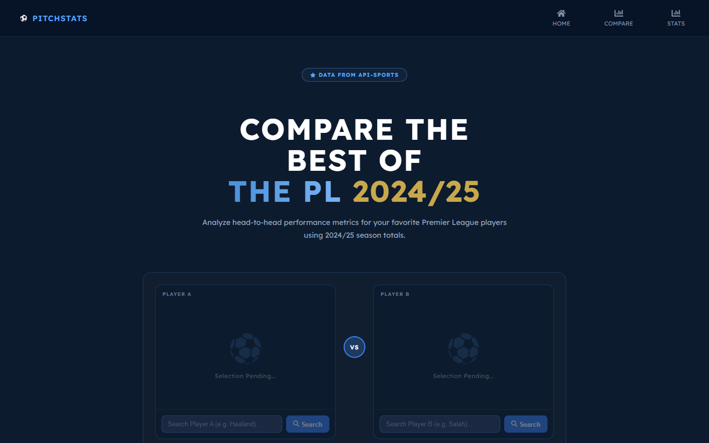
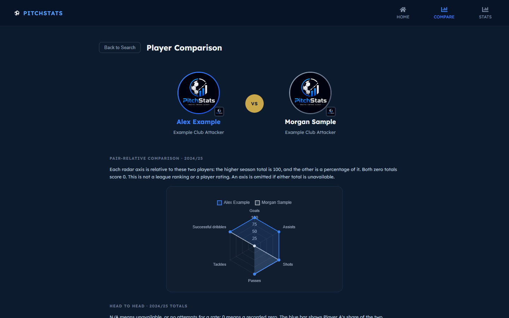
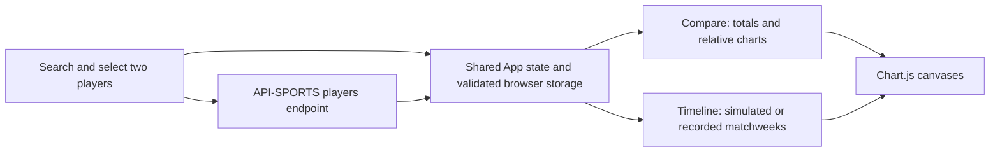

<p align="center"></p>

# PitchStats

**Premier League player comparison dashboard · React frontend**<br>
**Author:** Gedeon Kazadi · DV200, Semester 1

[Repository](https://github.com/GKaz17/dv200-football-dashboard) · [Live application](https://dv200-football-dashboard.vercel.app/)

## Contents

- [About the project](#about-the-project)
- [Getting started](#getting-started)
- [Features](#features)
- [Development process](#development-process)
- [Final outcome](#final-outcome)
- [Conclusion](#conclusion)
- [Credits and use terms](#credits-and-use-terms)

## About the project

PitchStats helps football fans compare two Premier League player-seasons without switching between disconnected statistics pages. Each player has an independent season selector, including comparisons of the same player in different years. Charts compare recorded season totals. Timeline offers separate simulated progression and recorded matchweek overlays. I built the project to practise API integration, data visualisation and responsive React interfaces.

**Technologies:** React 19, React Router, JavaScript, Chart.js, react-chartjs-2, React Icons, CSS, Create React App and the API-SPORTS Football API. The frontend is hosted on Vercel.

## Getting started

### Prerequisites

- Node.js and npm. The existing development setup uses Node.js 22.
- An API-SPORTS Football subscription/key with access to the requested Premier League season.
- Git and an internet connection for player searches.

### Frontend installation

```bash
git clone https://github.com/GKaz17/dv200-football-dashboard.git
cd dv200-football-dashboard
npm ci
```

Copy `.env.example` to `.env.local` and set your own provider key:

```env
REACT_APP_API_SPORTS_KEY=your_api_sports_key_here
```

```bash
npm start
```

Open [localhost:3000](http://localhost:3000/). Home, Compare and Timeline share one navigation bar. Names can be selected from search results or resolved by clicking Compare or Timeline in the navbar. Restart the development server after changing environment settings.

### Backend and data service

There is no project-owned backend or database to install. React requests API-SPORTS endpoints at `https://v3.football.api-sports.io`, using Premier League `39` and a separate season start year per player. Discovery has a 2016/17 floor and follows the newest covered season. Explicit plan restrictions narrow the choices; on 2 November 2026 the configured key allowed only 2022/23–2024/25, not 2016/17 or 2026/27. If the coverage service is slow, the provider's explicit allowed-year range supplies choices and each search checks actual player availability.

Recorded matchweek overlays load only on request. They default to matchweeks 1–6, adjustable to 38, and show a worst-case API-request estimate. The current free key rejects batched fixture IDs but permits individual fixture details, so the loader falls back to cached single-fixture requests. Loads estimated above 20 requests require an explicit quota-approval checkbox. Other quota or plan errors stop loading; missing statistics remain gaps, not zero. Successful searches are cached for five minutes and fixture/coverage responses for one hour.

Create React App embeds `REACT_APP_` values in the browser bundle. This configuration does not keep a provider key secret. A future server-side proxy would be needed for private credentials and central rate limits. `.gitignore` excludes local environment files; previously committed values still remain in Git history until separately addressed.

## Features

| Feature | Implemented behaviour |
| --- | --- |
| Player search | Search API-SPORTS with loading, empty-result, error, timeout and retry states. |
| Head-to-head comparison | Compare goals, assists, shots, tackles, passes, dribbles and derived rates. |
| Chart views | Radar, bar, pie and line charts; labels explain relative versus absolute scales. |
| Data integrity | Missing fields display as `N/A`, rather than becoming a recorded zero. |
| Simulated timeline | Stable seeded points end at the recorded total; these are not real monthly results. |
| Cross-season comparison | Independent season choices and season-labelled charts, including the same player across years. |
| Recorded overlays | Real counts aligned by matchweek, with bounded windows, request estimates and a free-plan fallback. |
| Navigation | One shared navbar and active-route indicator. Navbar and footer links resolve typed names and retain selected records. |
| Saved comparison | Draft names, seasons and fresh selected records survive reloads in the same browser. A Clear comparison control removes the saved pair. |
| Responsive interface | Desktop and mobile layouts with a collapsible navigation menu. |





These screenshots come from local functional checks. Populated comparison examples use test fixtures and do not establish live provider availability.

## Development process

### Architecture and user flow



`App.js` owns the selected pair, season choices, draft searches and navigation resolution. `selectionStorage.js` validates a minimal localStorage snapshot; it never stores the provider key. Selected statistics expire after 24 hours, while names and season choices remain for a fresh lookup. Malformed or blocked storage falls back safely to in-memory use. `playerSearch.js` handles provider access and caching. `playerData.js` normalises statistics, aggregates same-season club records after transfers and builds the simulation. `matchHistory.js` loads recorded matchweek details. There is no ERD because the project has no application database.

### Code decision: keep missing data distinct

From [`src/playerData.js`](src/playerData.js):

```js
export function percentage(part, total) {
  return part == null || total == null || total === 0
    ? null
    : Math.round((part / total) * 100);
}
```

An unavailable numerator or denominator produces `null`, which the interface formats as `N/A`. This avoids presenting incomplete provider data as a measured 0%. Radar axes compare the selected pair; they are not league percentiles.

### Challenges and testing

| Challenge | How I addressed it |
| --- | --- |
| Navbar links discarded player selection. | Moved the pair into shared application state. |
| Timeline values changed whenever controls rerendered. | Replaced unseeded randomness with a deterministic player-specific illustration. |
| Failed requests left users waiting. | Added abort/timeout handling, visible failure states and retry controls. |
| Feature descriptions implied unsupported analytics. | Matched copy to season totals, available fields and the simulated timeline. |

The 2 November local functional checkpoint passed **23 regression tests**, a production build and desktop/mobile browser checks down to 320px. Browser chart checks used fixtures; a live Salah search also succeeded, although provider availability was intermittent. These results describe that checkpoint, not a new production availability guarantee.

To reproduce the automated checks:

```bash
npm test -- --watchAll=false --runInBand
npm run build
```

## Final outcome

[Open PitchStats on Vercel](https://dv200-football-dashboard.vercel.app/).

**Demo video:** [Watch the full PitchStats demonstration](https://drive.google.com/file/d/1WWGqj-vrEvjOtSj7Xumpb5uaBySJV0GE/view). Runtime: **10:29**. This recording predates the November cleanup and exceeds the brief’s 5–8 minute limit; a shorter current demonstration is still required.

For Vercel, use Create React App, `npm ci`, `npm run build` and output directory `build`. Set the provider environment variable in the project settings. GitHub and Vercel both use the `main` production branch. Only pushed commits are available to the Git integration.

`vercel.json` explicitly serves the SPA entry for `/compare` and `/timeline`, so direct links and hard reloads use the same application shell rather than a separate page or a host 404. Browser storage is origin-specific: localhost selections do not transfer to the Vercel domain or to a different device. Recorded timeline windows and visibility toggles are view state; the saved snapshot contains the player pair, years and draft names.

## Conclusion

The strongest outcome is a clearer comparison experience: the pair survives navigation, chart scales are explained and missing data stays visible. The main challenge was making API-driven charts trustworthy when fields or requests fail.

Next I would add a server-side provider proxy, shareable comparison URLs, per-90-minute comparisons and deeper player profiles. Heatmaps, xG/xA analysis and exports are not implemented features.

## Credits and use terms

- **Author and contact:** [Gedeon Kazadi](https://github.com/GKaz17) · [gedeonkazadi017@yahoo.com](mailto:gedeonkazadi017@yahoo.com)
- **Course:** Open Window DV200 football analytics brief.
- **Libraries and scaffolding:** [React](https://react.dev/), [React Router](https://reactrouter.com/), [Create React App](https://create-react-app.dev/), [Chart.js](https://www.chartjs.org/), [react-chartjs-2](https://react-chartjs-2.js.org/) and [React Icons](https://react-icons.github.io/react-icons/). Dependency versions are recorded in the lockfile.
- **Data and player imagery:** [API-SPORTS Football](https://www.api-football.com/); provider terms and third-party rights apply.
- **Hosting:** Vercel. The existing PitchStats logo and interface are retained from the project assets.
- **AI assistance:** ChatGPT and Codex supported research into unfamiliar technical approaches, implementation, debugging and documentation.
- **Use terms:** Academic and portfolio project. No repository-wide open-source licence has been granted. Third-party packages and imagery retain their respective licences and rights.
